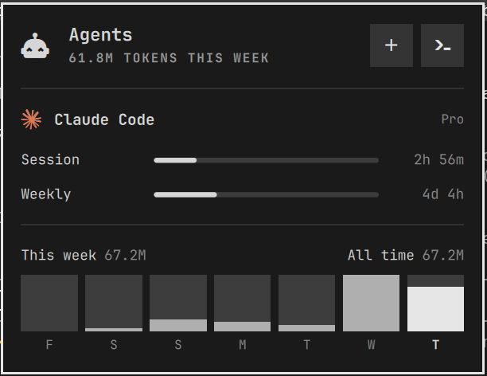

# Omarchy Agents Widget

The [Omarchy](https://omarchy.org) agents panel, with a weekly token chart.



This widget is a copy of Omarchy's built-in **Agents** bar widget (`omarchy.agents`). It changes one thing: the
*Make something cool* starter prompts are replaced with:

- **This week**: total tokens used across every agent in the last 7 days.
- **All time**: every token on record across every agent.
- **Daily bars**: one bar per day for the last 7 days. Today is highlighted, and hovering a bar shows that day's count.

Everything else is unchanged: limits, accounts, balances, cross-device sync, and the same data. It reads the usage
records Omarchy's own collectors write to `~/.local/state/omarchy/agents/usage/`, so every agent Omarchy supports
(Claude Code, Codex, Cursor, Copilot, OpenCode, and the rest) is counted without any setup.

## Install

```bash
omarchy plugin add https://github.com/LakhanxGupta/omarchy-agents-widget.git --enable
```

This replaces the built-in Agents icon in your bar. Restart the shell if it doesn't show up right away:

```bash
omarchy restart shell
```

## Update

```bash
omarchy plugin update lakhanxgupta.agents
```

## Uninstall / go back to the built-in widget

```bash
omarchy bar use omarchy.agents
omarchy plugin remove lakhanxgupta.agents
```

## Notes

- **"All time" means what's on disk.** Agents clean up their own logs. Claude Code, for example, deletes transcripts
  older than 30 days by default (`cleanupPeriodDays`). So "All time" covers as far back as your local history goes.
- **Other devices.** Only Cursor and Fireworks report account-wide usage, and those numbers are already included.
  For everything else, turn on the panel's built-in sync (Settings → *Synced aggregation*, plus a synced folder) on
  each machine.
- **Upstream changes.** This is a fork of the built-in panel, so it doesn't pick up Omarchy's updates to the agents
  widget automatically. The original panel documentation is in [UPSTREAM-README.md](UPSTREAM-README.md). Every
  change in `Panel.qml` is marked with a `Local edit` comment.

## License

MIT. Based on Omarchy's agents widget, © David Heinemeier Hansson. See [LICENSE](LICENSE).
